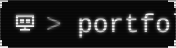

<picture>
  <source media="(max-width: 600px)" srcset="./assets/banner-mobile.svg">
  
</picture>

    <h2 align="">Who am I?</h2>

  I am a <strong>full-stack developer </strong> with <strong>+2.5 years of experience</strong>, focused on solving <strong>real-world problems</strong> with smart, efficient code. My goal is to turn challenges into <strong>practical solutions</strong> that make systems <strong>faster, more scalable, and easier to use</strong>.

  I have hands-on experience <strong>building and improving complex web applications</strong>, especially on the <strong>frontend with React and TypeScript</strong>. I've worked on <strong>refactoring legacy systems</strong> into <strong>modular architectures</strong>, optimizing <strong>performance</strong> with techniques like <strong>lazy loading and caching</strong>, and building <strong>data-intensive interfaces</strong> such as <strong>dashboards and advanced filtering systems</strong>.

  I enjoy working on problems related to <strong>performance, scalability, and code quality</strong>, and I'm constantly looking for ways to improve both the <strong>user experience</strong> and the <strong>developer experience</strong>.

    

        <a href="https://www.linkedin.com/in/sebastianherreramon"><picture><source media="(max-width: 600px)" srcset="./assets/btn-linkedin-mobile.svg"></picture></a>
        <a href="mailto:sebashm621@gmail.com"><picture><source media="(max-width: 600px)" srcset="./assets/btn-gmail-mobile.svg"></picture></a>
        <a href="https://portafolio-joansebhm.vercel.app/"><picture><source media="(max-width: 600px)" srcset="./assets/btn-portfolio-mobile.svg"></picture></a>
        <a href="https://www.hackerrank.com/sebashm621"><picture><source media="(max-width: 600px)" srcset="./assets/btn-hackerrank-mobile.svg"></picture></a>
    

---

    <a href="https://github.com/JoansebHM?tab=repositories">
        <picture>
            <source media="(max-width: 600px)" srcset="./assets/stats-card-mobile.svg">
            
        </picture>
    </a>

